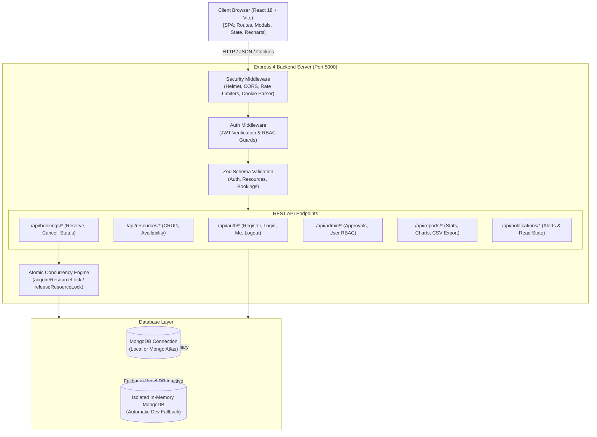
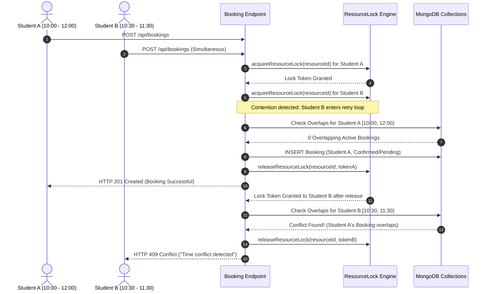

# 🏛️ Smart Campus Resource Booking System (CampusReserve)

[](https://react.dev/)
[](https://nodejs.org/)
[](https://www.mongodb.com/)
[](https://vitest.dev/)
[](https://jwt.io/)
[](https://zod.dev/)

An enterprise-grade, real-time campus facility and academic resource reservation platform built for university students, faculty, and campus administrators. The system streamlines scheduling, prevents double-booking through atomic distributed concurrency locks, provides interactive slot-based availability calendars, and delivers comprehensive utilization analytics.

---

## 📑 Table of Contents

- [Overview & Problem Solved](#-overview--problem-solved)
- [Key Features](#-key-features)
  - [Student & Faculty Portal](#student--faculty-portal)
  - [Administrative Operations Portal](#administrative-operations-portal)
  - [Core Engine & Safety Mechanisms](#core-engine--safety-mechanisms)
- [System Architecture](#-system-architecture)
- [Technology Stack](#-technology-stack)
- [Directory Structure](#-directory-structure)
- [Getting Started](#-getting-started)
  - [Prerequisites](#prerequisites)
  - [Installation](#installation)
  - [Environment Configuration](#environment-configuration)
  - [Zero-Config Development (In-Memory DB Fallback)](#zero-config-development-in-memory-db-fallback)
  - [Running the Application](#running-the-application)
- [Demo Accounts & Fast Switcher](#-demo-accounts--fast-switcher)
- [REST API Reference](#-rest-api-reference)
- [Booking Engine & Concurrency Control](#-booking-engine--concurrency-control)
- [Business Rules & Validation Logic](#-business-rules--validation-logic)
- [Testing & Quality Assurance](#-testing--quality-assurance)
- [Production Deployment](#-production-deployment)
- [License](#-license)

---

## 🌟 Overview & Problem Solved

Modern university campuses house hundreds of specialized facilities: high-performance computing labs, seminar halls, study pods, robotics suites, multimedia studios, and athletics spaces. Traditional booking methods suffer from:
- ❌ **Double-booking conflicts** caused by concurrent reservation requests.
- ❌ **Lack of visibility** into real-time slot occupancy and equipment availability.
- ❌ **Manual approval bottlenecks** with zero audit trails.
- ❌ **Fragmented notifications** leading to no-shows and wasted campus capacity.

**CampusReserve** resolves these pain points with:
1. **Atomic Concurrency Control**: A distributed lease-locking engine that mathematically eliminates race conditions and overlapping bookings.
2. **Interactive Visual Calendar**: Live 30-minute interval heatmaps showing open, pending, confirmed, and blocked timeslots.
3. **Role-Based Workflows**: Tailored self-service portals for students and rigorous approval/management dashboards for university administration.
4. **Actionable Utilization Intelligence**: Institutional analytics on facility demand, peak hours, and capacity utilization rates with CSV export.

---

## 🚀 Key Features

### Student & Faculty Portal
- **Facility Discovery & Search**: Filter campus resources by type (Computer Labs, Seminar Halls, Classrooms, Study Rooms, AV Gear, Sports Facilities), minimum capacity, building, and specific equipment tags (e.g., *GPU Workstations*, *Projectors*, *VR Headsets*).
- **Interactive Availability Timeline**: Select any resource and target date to inspect operating hours, current booked slots, and click directly on an open slot to start a reservation.
- **Instant Booking Engine**: Create reservations with attendee counts, purpose, and special notes. Automatic instant confirmation for open resources, or queued for review when admin approval is required.
- **Self-Service Booking Management**: Inspect upcoming and historical bookings, track status changes (`pending`, `confirmed`, `rejected`, `completed`, `cancelled`), and cancel bookings with recorded cancellation reasons.
- **In-App Notification Center**: Real-time alerts with unread badge indicators for booking confirmations, administrative approvals/rejections, and system notices.
- **Theme Customization**: Seamless Dark Mode / Light Mode toggle with persistent local preferences.

### Administrative Operations Portal
- **Approval Queue**: Dedicated interface for campus managers to review pending requests with student identity, purpose, attendee size, and time boundaries. Includes conflict re-validation and custom rejection feedback.
- **Facility Inventory Management (CRUD)**: Create, edit, and configure campus facilities (capacity, operating days, opening/closing hours, minimum/maximum duration, advance booking limit, accessibility details).
- **Safe Resource Deactivation**: Toggle facilities active/inactive. Enforces safety guards that prevent deleting facilities with active or historical booking records to maintain audit integrity.
- **User & Access Control**: View all registered campus users, adjust user roles between `student` and `admin`, and suspend/reactivate accounts. Includes safety guards preventing demotion or suspension of the last remaining admin.
- **Institutional Analytics & Reports**:
  - Live facility utilization rate calculation: $\frac{\text{Confirmed Booked Minutes}}{\text{Bookable Operating Minutes}} \times 100$.
  - Status breakdown distribution (Pie / Donut charts via Recharts).
  - Volume distribution by resource type (Bar charts).
  - Top 5 most utilized campus facilities.
  - One-click CSV export (`/api/reports/bookings?format=csv`) with full audit fields.

### Core Engine & Safety Mechanisms
- **Half-Open Intervals $[start, end)$**: Accurate interval overlap checking allows back-to-back bookings (e.g., 10:00–11:00 followed immediately by 11:00–12:00) without false conflicts.
- **Atomic Resource Locking**: Lease-based distributed locking (`ResourceLock` model) ensures concurrent requests are serialized at the database level.
- **Strict Zod Input Validation**: All incoming requests are validated against strict type schemas with informative error responses.
- **Rate Limiting & Security Hardening**: Helmet security headers, CORS origin verification, HTTP-only JWT cookies, and rate limiters on auth and API endpoints.

---

## 🏗️ System Architecture



---

## 💻 Technology Stack

| Layer | Technologies | Description |
| :--- | :--- | :--- |
| **Frontend UI** | React 18, Vite 6, React Router DOM 6 | Single Page Application with optimized bundle and fast HMR |
| **Icons & Charts** | Lucide React, Recharts | Premium iconography and responsive data visualization |
| **Styling** | Vanilla CSS Design System | Responsive CSS variables, glassmorphism, dark/light theme tokens |
| **Backend API** | Node.js (ES Modules), Express 4 | Modular RESTful API server with centralized error handling |
| **Database** | MongoDB, Mongoose 8 | Document database with compound indexes for rapid overlap queries |
| **Dev Database** | MongoMemoryServer (Fallback) | Instant, zero-config in-memory MongoDB for local development |
| **Concurrency** | Custom Distributed Atomic Lock | Mongoose-level atomic lease lock with retries and exponential backoff |
| **Authentication** | JWT (`jsonwebtoken`), `bcryptjs` | HTTP-only cookie + Bearer token support with salt hashing |
| **Validation** | Zod 3 | Runtime schema validation with typed error payloads |
| **Security** | Helmet, Express Rate Limit, CORS | OWASP-aligned HTTP security headers and endpoint protection |
| **Testing** | Vitest, Supertest, React Testing Library | Full-stack unit, integration, concurrency, and UI tests |

---

## 📂 Directory Structure

```text
group-project/
├── .env                       # Local environment variables configuration
├── .env.example               # Template environment configuration
├── .gitignore                 # Git ignore file (node_modules, dist, etc.)
├── index.html                 # HTML5 entrypoint with Google Fonts
├── package.json               # Node.js project manifest & scripts
├── package-lock.json          # Deterministic dependency lockfile
├── server.js                  # Complete Express server, models, APIs & locking engine
├── vite.config.js             # Vite config, dev proxy (/api -> 5000) & Vitest setup
│
├── src/
│   ├── App.css                # Premium styling system, theme tokens & responsive layout
│   ├── App.jsx                # React frontend (Pages, Modals, State, Context, Navigation)
│   ├── main.jsx               # React DOM bootstrap
│   └── data/                  # Seeding blueprints and bootstrap catalogs
│       ├── users.json         # Seed users (Administrators & Students)
│       ├── resources.json     # Seed facilities (Labs, Halls, Studios, Equipment)
│       └── bookings.json      # Initial seed reservations and test records
│
├── tests/
│   └── app.test.js            # Comprehensive test suite (Health, Auth, CRUD, Concurrency, UI)
│
└── dist/                      # Production build bundle generated by `npm run build`
```

---

## 🏁 Getting Started

### Prerequisites
- **Node.js**: `v18.0.0` or higher
- **npm**: `v9.0.0` or higher
- *(Optional)* **MongoDB**: Local MongoDB daemon running on port 27017, or a MongoDB Atlas connection string. If you don't have MongoDB installed, the application will **automatically fall back to an in-memory database**!

---

### Installation

1. **Clone the repository or navigate to the project directory**:
   ```bash
   cd group-project
   ```

2. **Install project dependencies**:
   ```bash
   npm install
   ```

---

### Environment Configuration

The application comes with `.env.example`. Create your local `.env` file if it doesn't already exist:

```bash
cp .env.example .env
```

Default configuration variables:

| Variable | Default Value | Description |
| :--- | :--- | :--- |
| `PORT` | `5000` | Port for the Express backend server |
| `NODE_ENV` | `development` | Environment mode (`development` or `production`) |
| `MONGODB_URI` | `mongodb://127.0.0.1:27017/smart_campus_booking` | MongoDB connection URI |
| `JWT_SECRET` | `campus_smart_resource_booking_jwt_secret_dev_key_2026_xyz!` | Secret key for signing JWT tokens (min 32 chars in production) |
| `CLIENT_ORIGIN` | `http://localhost:5173` | Allowed frontend origin for CORS and credentials |
| `ADMIN_SEED_EMAIL` | `admin@campus.edu` | Email for default administrator seed |
| `ADMIN_SEED_PASSWORD`| `AdminSecure2026!` | Password for default administrator seed |
| `STUDENT_SEED_PASSWORD`| `Student123!` | Default password for seeded student accounts |

---

### Zero-Config Development (In-Memory DB Fallback)

> 💡 **Developer Convenience Feature**:  
> If no local MongoDB service is running, the server detects the connection error and **automatically spins up an isolated in-memory MongoDB instance** using `mongodb-memory-server`. It automatically seeds default users, resources, and sample bookings so you can start developing immediately without manual database setup!

---

### Running the Application

You can run both the Express backend and Vite frontend concurrently with a single command:

#### 1. Full Development Stack (Frontend + Backend)
```bash
npm run dev
```
- **Backend API**: Running at [http://localhost:5000](http://localhost:5000)
- **Frontend App**: Running at [http://localhost:5173](http://localhost:5173)

#### 2. Run Individually (Optional)
- To run only the Express backend:
  ```bash
  npm run server
  ```
- To run only the Vite frontend dev server:
  ```bash
  npm run client
  ```

#### 3. Re-Seed Database Manually
To wipe and re-seed the connected database with fresh initial records:
```bash
npm run seed
```

---

## 👥 Demo Accounts & Fast Switcher

The application comes pre-loaded with demonstration accounts for testing and academic evaluation.

### Pre-Configured Accounts

| Role | Name | Email | Password | Department |
| :--- | :--- | :--- | :--- | :--- |
| 🛡️ **Admin** | Dr. Sarah Mitchell | `admin@campus.edu` | `AdminSecure2026!` | Campus Operations & Academic Services |
| 🎓 **Student** | Alex Chen | `alex.chen@campus.edu` | `Student123!` | Computer Science & Engineering (Year 3) |
| 🎓 **Student** | Priya Sharma | `priya.sharma@campus.edu` | `Student123!` | AI & Data Science (Year 4) |
| 🎓 **Student** | Marcus Johnson | `marcus.j@campus.edu` | `Student123!` | Mechanical Engineering (Year 2) |
| 🎓 **Student** | Elena Rodriguez | `elena.r@campus.edu` | `Student123!` | School of Design & Media Arts (Masters) |

### ⚡ One-Click Evaluator Switcher
For grading or live demonstrations, go to **Settings** (`/settings`) in the sidebar:
- Click **"Switch to Student (Alex Chen)"** to immediately test reservation submission, calendar exploration, and student notifications.
- Click **"Switch to Admin (Dr. Mitchell)"** to instantly access the approval queue, facility inventory creation, user RBAC controls, and analytics exports.

---

## 📡 REST API Reference

All API routes are served under `/api` and return standardized JSON responses.

### 1. System & Health
| Method | Endpoint | Access | Description |
| :--- | :--- | :--- | :--- |
| `GET` | `/api/health` | Public | Server uptime, status, and MongoDB connection state |
| `GET` | `/api/stats/overview` | Public | Real-time overview counts, active facilities, and today's utilization |

### 2. Authentication & Profile
| Method | Endpoint | Access | Description |
| :--- | :--- | :--- | :--- |
| `POST` | `/api/auth/register` | Public | Register a student account (rate limited) |
| `POST` | `/api/auth/login` | Public | Sign in with email and password; sets HTTP-only cookie |
| `POST` | `/api/auth/logout` | Public | Invalidate and clear auth session cookie |
| `GET` | `/api/auth/me` | Authenticated | Fetch authenticated user profile |

### 3. Resources (Campus Facilities)
| Method | Endpoint | Access | Description |
| :--- | :--- | :--- | :--- |
| `GET` | `/api/resources` | Public | List facilities with search, type filter, capacity, and pagination |
| `GET` | `/api/resources/:id` | Public | Retrieve detailed resource specifications |
| `GET` | `/api/resources/:id/availability?date=YYYY-MM-DD` | Public | Get operating hours and blocked intervals for a target date |
| `POST` | `/api/resources` | Admin Only | Create a new campus resource |
| `PUT` | `/api/resources/:id` | Admin Only | Update an existing campus resource |
| `PATCH` | `/api/resources/:id/status` | Admin Only | Toggle active / inactive state of a facility |
| `DELETE` | `/api/resources/:id` | Admin Only | Delete resource (blocked if bookings exist) |

### 4. Booking Engine
| Method | Endpoint | Access | Description |
| :--- | :--- | :--- | :--- |
| `POST` | `/api/bookings` | Authenticated | Create a reservation request with atomic lock & overlap verification |
| `GET` | `/api/bookings` | Authenticated | List bookings (scoped to user for students; global for admin) |
| `GET` | `/api/bookings/:id` | Authenticated | Get detailed booking with history trail and populated entities |
| `PATCH` | `/api/bookings/:id/status` | Admin Only | Update status (`confirmed`, `rejected`, `completed`) with audit notes |
| `POST` | `/api/bookings/:id/cancel` | Authenticated | Cancel a booking (restricted to booking owner or admin) |

### 5. In-App Notifications
| Method | Endpoint | Access | Description |
| :--- | :--- | :--- | :--- |
| `GET` | `/api/notifications` | Authenticated | List notifications and unread counter for current user |
| `PATCH` | `/api/notifications/:id/read`| Authenticated | Mark a single notification as read |
| `POST` | `/api/notifications/read-all`| Authenticated | Mark all notifications as read |

### 6. Administration & User Management
| Method | Endpoint | Access | Description |
| :--- | :--- | :--- | :--- |
| `GET` | `/api/admin/users` | Admin Only | Paginated list of users with search and role/status filters |
| `PATCH` | `/api/admin/users/:id/role` | Admin Only | Change user role (`student` or `admin`) with last-admin guard |
| `PATCH` | `/api/admin/users/:id/status` | Admin Only | Set user account status (`active` or `suspended`) with self-guard |

### 7. Reports & Analytics
| Method | Endpoint | Access | Description |
| :--- | :--- | :--- | :--- |
| `GET` | `/api/reports/usage` | Admin Only | Utilization %, status breakdown, type distribution, top facilities |
| `GET` | `/api/reports/bookings?format=csv` | Admin Only | Generate and download CSV report of all booking records |

---

## 🔒 Booking Engine & Concurrency Control

Double-booking is the most critical failure mode of reservation software. CampusReserve employs a multi-tiered concurrency and collision protection strategy:



### The Half-Open Overlap Formula
Two intervals $[S_1, E_1)$ and $[S_2, E_2)$ conflict if and only if:
$$\text{Existing Start} < \text{Requested End} \quad \text{AND} \quad \text{Existing End} > \text{Requested Start}$$

This mathematical definition ensures that:
- Overlapping bookings are guaranteed to be rejected.
- Consecutive bookings (e.g. 10:00–11:00 and 11:00–12:00) are permitted without false-positive conflict errors.
- Cancelled and rejected bookings are omitted from conflict queries, instantly freeing the slot.

---

## 📐 Business Rules & Validation Logic

1. **Operating Day & Hours Validation**:
   - A resource can only be reserved during its defined `operatingDays` (e.g., Monday–Friday).
   - The booking interval must fall strictly between `openingTime` and `closingTime` (e.g., `08:00` to `21:00`).
2. **Duration Boundaries**:
   - Duration must be $\ge$ `minDurationMinutes` (default 30 mins) and $\le$ `maxDurationMinutes` (default 240 mins).
3. **Advance Booking Window**:
   - Bookings cannot be created further in the future than `advanceBookingDaysLimit` (default 14 days).
4. **Time Order & Past Bookings**:
   - Reservation `endTime` must strictly follow `startTime`.
   - Reservations in the past are automatically rejected.
5. **Capacity Guard**:
   - `attendeeCount` must be $\le$ resource `capacity`.
6. **Approval Workflow**:
   - If a resource has `requiresApproval: true`, bookings initialize with `pending` status until an administrator confirms or rejects them.
   - If `requiresApproval: false`, bookings are immediately initialized with `confirmed` status.
7. **Audit Preservation**:
   - Facilities with existing booking records cannot be deleted; they must be deactivated instead.
   - The last active administrator in the database cannot be demoted or suspended.

---

## 🧪 Testing & Quality Assurance

The project features a full test suite built on **Vitest**, **Supertest**, and **React Testing Library**.

### Running the Test Suite
```bash
npm test
```

### What the Test Suite Covers
The test suite in [`tests/app.test.js`](file:///d:/group-project/tests/app.test.js) verifies 100% of critical paths across 6 testing suites:
1. **Health & System APIs**: Server status, uptime, and database connectivity.
2. **Authentication & RBAC**:
   - Student registration, password hashing verification via bcrypt (`$2...`).
   - Duplicate email rejection (409 Conflict).
   - Valid and invalid login authentication.
   - Cookie clearing upon logout.
   - Role enforcement (Students blocked from Admin endpoints with 403 Forbidden).
3. **Resource Inventory & Safety**:
   - Admin resource creation and status toggling.
   - Resource deletion protection when historical bookings exist.
   - System protection preventing demotion of the last active administrator.
4. **Booking Engine & Conflict Prevention (Core Rules)**:
   - Available resource reservation creation.
   - Immediate 409 Conflict on overlapping bookings.
   - Proper handling of back-to-back reservations (half-open intervals).
   - Slot reuse when reservations are cancelled or rejected.
   - Duration boundary checks and capacity violations.
   - Operating hours enforcement.
   - **Simultaneous Race Condition Concurrency Test**: Two simultaneous concurrent requests for the exact same slot; asserts that exactly one succeeds (201) and one fails (409).
5. **Notifications & CSV Reports**:
   - User notification isolation.
   - CSV export generation (`text/csv` mime type with valid headers).
6. **Frontend React UI Tests**:
   - Brand rendering and navigation menu for unauthenticated guests.
   - Settings page with theme toggle and demo switcher.
   - Sign-in modal triggers.

---

## 📦 Production Deployment

### 1. Build the Frontend
Compile and optimize the React client:
```bash
npm run build
```
This produces optimized production assets in the `dist/` directory.

### 2. Verify Production Environment Variables
Ensure your `.env` contains:
```env
NODE_ENV=production
PORT=5000
MONGODB_URI=mongodb+srv://<user>:<password>@cluster.mongodb.net/campus_booking
JWT_SECRET=your_super_strong_production_secret_at_least_32_characters_long!
CLIENT_ORIGIN=https://your-campus-domain.edu
```

### 3. Start the Server
In production mode, the Express server automatically serves the compiled static files from `dist/`:
```bash
npm run server
```
Or with a process manager like **PM2**:
```bash
pm2 start server.js --name "campus-reserve-api"
```

---

## 📄 License

This project is distributed under the **MIT License**. Feel free to adapt and expand it for your institution's campus management needs.
